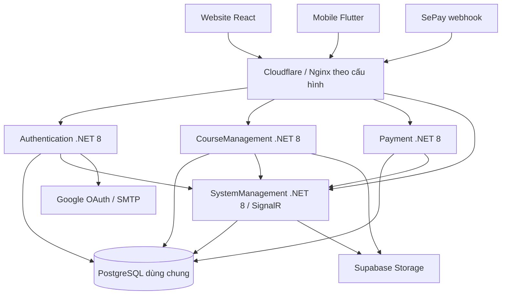

# EDUMY – Project Progress & Status Report

**Ngày khảo sát:** 12/10/2026 — múi giờ Asia/Ho_Chi_Minh. 
**Phạm vi:** workspace `Edumy`, gồm backend, website, mobile, hạ tầng, thiết kế, đặc tả nghiệp vụ và website giới thiệu. 
**Phương pháp:** audit tĩnh mã nguồn, cấu hình, dependency/lockfile, tài liệu, workflow và lịch sử Git cục bộ.
**Đầu ra:** chỉ tạo báo cáo này; không sửa mã ứng dụng, không chạy build/test/lint, không gọi API, không truy cập production, không thực hiện thanh toán hoặc migration.

> Báo cáo phản ánh checkout tại thời điểm đọc, không chứng nhận bản đang chạy trên VPS. “Đã triển khai” nghĩa là có mã thực hiện chức năng; không đồng nghĩa đã hoạt động đúng trong mọi tình huống hoặc đã nghiệm thu. Những nhận định về hiệu năng và lỗi runtime bên dưới là suy luận có căn cứ từ mã, chưa được tái hiện bằng chạy hệ thống.

## Mục lục

1. [Kết luận điều hành](#1-kết-luận-điều-hành)
2. [Phạm vi, bằng chứng và baseline](#2-phạm-vi-bằng-chứng-và-baseline)
3. [Kiến trúc và công nghệ](#3-kiến-trúc-và-công-nghệ)
4. [Backend](#4-backend)
5. [Dữ liệu và migration](#5-dữ-liệu-và-migration)
6. [Frontend web](#6-frontend-web)
7. [Frontend mobile](#7-frontend-mobile)
8. [Tiến độ chức năng và tích hợp](#8-tiến-độ-chức-năng-và-tích-hợp)
9. [Hạ tầng, triển khai và vận hành](#9-hạ-tầng-triển-khai-và-vận-hành)
10. [Kiểm thử và chất lượng](#10-kiểm-thử-và-chất-lượng)
11. [Phát hiện và mức ưu tiên](#11-phát-hiện-và-mức-ưu-tiên)
12. [Độ lệch tài liệu và phạm vi sản phẩm](#12-độ-lệch-tài-liệu-và-phạm-vi-sản-phẩm)
13. [Lộ trình khắc phục và tiêu chí nghiệm thu](#13-lộ-trình-khắc-phục-và-tiêu-chí-nghiệm-thu)
14. [Giới hạn và danh mục bằng chứng](#14-giới-hạn-và-danh-mục-bằng-chứng)

## 1. Kết luận điều hành

### 1.1. Hiện trạng tổng thể

Edumy đã vượt giai đoạn prototype: có nền tảng học trực tuyến với xác thực, phân quyền, danh mục khóa học/đề thi, học nội dung, làm bài và lưu dở, thanh toán QR/webhook, chứng chỉ, quản trị, báo cáo, chat và thông báo. Website có cả màn hình học viên, giảng viên, Admin/Maintainer; mobile tập trung học viên và một phần trải nghiệm giảng viên.

Backend gồm **4 ứng dụng ASP.NET Core .NET 8**, dùng **PostgreSQL qua EF Core/Npgsql**. Website dùng **React 19, TypeScript 6, Vite 8**. Mobile dùng **Flutter/Dart, Riverpod, Dio và GoRouter**. Hạ tầng triển khai bằng Docker Compose, Nginx, GHCR và GitHub Actions trên một VPS theo cấu hình hiện có.

Kiến trúc thực tế là **nhiều dịch vụ cùng truy cập cơ sở dữ liệu dùng chung**, có giao tiếp HTTP nội bộ cho thông báo. Đây là khác biệt quan trọng với hình dung microservices sở hữu database riêng. SystemManagement giữ toàn bộ migration; các module còn lại khai báo lại phần model/context cần dùng.

### 1.2. Đánh giá mức sẵn sàng

| Mục đích                         | Đánh giá từ audit tĩnh                                                                | Điều kiện còn thiếu                                                                         |
| -------------------------------- | ------------------------------------------------------------------------------------- | ------------------------------------------------------------------------------------------- |
| Demo chức năng chính             | Có nền tảng mã đủ rộng để chuẩn bị demo                                               | Chạy lại luồng hoàn chỉnh với dữ liệu thử, xác minh cấu hình và media trong container       |
| Bàn giao cho kỹ sư phát triển    | Khá thuận lợi nhờ phân lớp, API layer và tài liệu phong phú                           | Chốt phiên bản từng repo, làm sạch độ lệch tài liệu, đưa test vào CI                        |
| Nghiệm thu khóa luận             | Có nhiều chức năng đã triển khai; chưa đủ căn cứ xác nhận hoàn thành toàn bộ đề cương | Ma trận yêu cầu–bằng chứng chạy thực tế, quyết định phạm vi AI/rút tiền, nghiệm thu mobile  |
| Vận hành production có thu tiền  | **Chưa đủ căn cứ để chấp nhận sẵn sàng**                                              | Xử lý cấu hình chứa secrets, vòng đời token/đơn/voucher, release checks, backup và phục hồi |
| Scale nhiều instance/tải thi lớn | Chưa được chứng minh                                                                  | Queue bền vững cho job, đồng bộ SignalR, đánh giá DB và tải, theo dõi vận hành              |

Không đưa ra tỷ lệ “hoàn thành X%” toàn dự án: chưa có baseline phạm vi hiện hành, trọng số chức năng và tiêu chí nghiệm thu thống nhất. Đếm endpoint, màn hình hoặc commit không thay thế tiến độ nghiệp vụ.

### 1.3. Điểm mạnh đã có bằng chứng

- API mặc định yêu cầu đăng nhập, có policy Admin/Maintainer/Instructor và kiểm tra sở hữu tại nhiều luồng học, thi, chat, chứng chỉ.
- Web có tầng API/query riêng, TypeScript strict, request cancellation, refresh single-flight, hỗ trợ Việt/Anh và shared UI.
- Mobile dùng Hive mã hóa cho phiên, khóa mã hóa trong secure storage; có test cho session, router, checkout, học/thi và chat.
- Thanh toán lưu snapshot item/giá, dùng transaction, kiểm tra số tiền/tài khoản và unique transaction ID; không chỉ tin kết quả hiển thị ở frontend.
- Thông báo có outbox trong PostgreSQL, lease, retry và `LISTEN/NOTIFY`; chat có idempotency bằng `ClientMessageId` và kiểm tra người tham gia.
- Migration có constraint cho đánh giá, chat, tiến độ và giao dịch; lịch sử Git cho thấy các module chính tiếp tục được cập nhật trong tháng 10.

### 1.4. Các vấn đề ưu tiên

1. **Cấu hình được Git quản lý chứa literal tại các trường bí mật**, bao gồm JWT, SMTP, OAuth, Supabase, webhook và bootstrap admin. Chưa xác minh credential còn hiệu lực; vẫn cần xử lý như khả năng lộ credential.
2. **Vòng đời phiên chưa chặt:** đổi mật khẩu không thu hồi refresh token trong action tương ứng; refresh không chặn `InActive`; access JWT không có cơ chế kiểm tra stamp/revocation trong pipeline đã đọc.
3. **Vòng đời thanh toán chưa khép kín:** webhook không yêu cầu đơn còn Pending/chưa hết hạn trước khi cấp quyền; voucher được tiêu thụ lúc tạo đơn nhưng nhánh hết hạn không hoàn lại.
4. **Cấu hình release còn khoảng trống:** health endpoint Course không khai báo anonymous; Docker Course chưa bảo đảm đưa FFmpeg/FFprobe vào runtime; Android release ký bằng debug key.
5. **CI chưa chạy bộ test nghiệp vụ:** BE chủ yếu build/publish, web lint/typecheck/build; các script API/chat chưa nằm trong workflow CI web; mobile không có workflow được Git quản lý.
6. **Tài liệu đề cương và thực tế khác nhau:** PostgreSQL thay MySQL; không thấy Redis/AI service thực thi trong phạm vi khảo sát; các số liệu API và cảnh báo bảo mật cũ chưa đồng bộ.

## 2. Phạm vi, bằng chứng và baseline

### 2.1. Cấu trúc workspace

Gốc workspace không phải Git repository hợp lệ để chạy `git status` toàn dự án. Các thư mục bên dưới có Git repository riêng. Vì vậy không tồn tại một commit chung duy nhất đại diện toàn hệ thống.

| Repository                         | Nhánh đọc được | HEAD tại khảo sát | Thời điểm commit HEAD | File được Git quản lý |
| ---------------------------------- | -------------- | ----------------- | --------------------- | --------------------: |
| `BE/AuthenticationModule`          | `dev`          | `a154420`         | 11/10/2026 19:25 +07  |                   208 |
| `BE/CourseManagementModule`        | `dev`          | `fbbc0f9`         | 12/10/2026 10:02 +07  |                   474 |
| `BE/PaymentModule`                 | `dev`          | `5e34df2`         | 27/09/2026 23:58 +07  |                   218 |
| `BE/SystemManagementModule`        | `dev`          | `2a516c7`         | 12/10/2026 10:01 +07  |                   566 |
| `FE/EWebsite`                      | `dev`          | `8fcee32`         | 12/10/2026 12:50 +07  |                 1.226 |
| `FE/Emobile`                       | `dev`          | `a06ca8e`         | 11/10/2026 22:14 +07  |                   476 |
| `Infra`                            | `dev`          | `0692b8c`         | 28/09/2026 00:02 +07  |                    10 |
| `Design`                           | `main`         | `1dcf835`         | 12/10/2026 11:07 +07  |                   619 |
| `bussiness-diagram`                | `main`         | `25733f6`         | 10/10/2026 12:05 +07  |                    35 |
| `Introduce/EdumyVietNam.github.io` | `main`         | `d067a4e`         | 17/06/2026 10:06 +07  |                    18 |

Số file tính bằng `git ls-files` từng repo, không gồm dependency/build output không được quản lý. Bảng không tính repository cấu hình riêng `Introduce/.github`. Không suy ra sức khỏe dự án từ số file hoặc ngày commit.

Ở lần đọc trạng thái đầu tiên, mobile báo `M scripts/flutter-env.sh`; lần kiểm tra sau không còn thay đổi và diff không có nội dung. Audit không sửa file này. Đây là dấu hiệu workspace có thể thay đổi đồng thời; baseline cần được chốt lại khi phát hành. Các repository chính còn lại sạch ở lần kiểm tra đầu.

### 2.2. Quy ước trạng thái

| Trạng thái           | Ý nghĩa                                                                      |
| -------------------- | ---------------------------------------------------------------------------- |
| Đã triển khai        | Có mã đường đi chính và thành phần giao tiếp liên quan                       |
| Một phần             | Có một số bước nhưng còn thiếu nền tảng, chức năng hoặc vòng đời             |
| Chưa thấy triển khai | Không tìm thấy thành phần thực thi tương ứng trong nguồn đã khảo sát         |
| Chưa xác minh        | Cần build/test, thiết bị, dữ liệu, cấu hình cloud hoặc runtime ngoài phạm vi |
| Không thuộc client   | Chức năng được xác định phục vụ client khác; không coi là thiếu mặc định     |

**Độ chắc chắn:** “Cao” cho hành vi/cấu hình đọc trực tiếp; “Trung bình” cho tác động runtime suy luận từ nhiều file; “Chưa xác minh” cho hoạt động dịch vụ bên ngoài. “Chưa thấy” không khẳng định thành phần không tồn tại ở repository hoặc môi trường chưa được cung cấp.

### 2.3. Các hoạt động đã thực hiện

- Đọc quy ước tại `FE/EWebsite/AGENTS.md`, `FE/EWebsite/.codex/AGENTS.md`, `FE/Emobile/.codex/AGENTS.md`.
- Đọc entrypoint, controller/service quan trọng, context/model/migration, router, transport/session và workflow.
- Đếm file được quản lý, khai báo controller/HTTP, test source; dùng TypeScript compiler API **chỉ phân tích tĩnh** để đếm member của API object.
- Đối chiếu manifest với lockfile, mã triển khai với audit cũ/đề cương/use case.
- Kiểm tra sự hiện diện của giá trị literal tại trường bí mật trong file được Git quản lý; không in hoặc lưu giá trị vào báo cáo.

Không chạy các script `api:check`, `chat:check`, test runner, compiler build, Docker, Flutter hoặc truy vấn database. Việc sử dụng parser TypeScript để đọc type không phải kết quả kiểm thử API.

## 3. Kiến trúc và công nghệ

### 3.1. Sơ đồ hiện trạng

Sơ đồ thể hiện cấu hình/mã, không khẳng định các dịch vụ bên ngoài đang kết nối thành công. Queue email/media/import nằm trong tiến trình; outbox thông báo nằm trong PostgreSQL.

### 3.2. Công nghệ xác định từ nguồn

| Tầng                     | Công nghệ và phiên bản quan sát                                                     | Vai trò / ghi chú                                                    |
| ------------------------ | ----------------------------------------------------------------------------------- | -------------------------------------------------------------------- |
| Backend runtime          | `net8.0` ở các project                                                              | ASP.NET Core API; không suy ra SDK cài trên VPS                      |
| Database                 | PostgreSQL, EF Core/Npgsql `8.0.11` ở model/context                                 | Compose chọn PostgreSQL qua biến `POSTGRES_VERSION`; README mô tả 16 |
| Auth                     | ASP.NET Identity, JwtBearer `8.0.11`, JWT HMAC                                      | Role/policy và refresh token hash trong DB                           |
| DI / mapping             | Autofac `8.3.0`, Autofac integration `10.0.0`, AutoMapper `16.1.1`                  | Đăng ký qua module riêng                                             |
| API documentation        | Swashbuckle `6.6.2`                                                                 | Swagger v2 và XML comments                                           |
| File / nội dung          | Supabase C# `0.16.2`, ClosedXML `0.104.2`, QuestPDF `2025.7.4`, ImageSharp `3.1.11` | Storage, nhập câu hỏi, PDF/chứng chỉ, ảnh; tùy project               |
| Media                    | FFmpeg/FFprobe có binary trong repository Course                                    | Cần bảo đảm phân phối vào container runtime                          |
| Realtime                 | ASP.NET SignalR; web `@microsoft/signalr`; mobile `signalr_netcore 1.4.4`           | Chat và thông báo                                                    |
| Web                      | React lock `19.2.7`; Vite `8.0.16`; TypeScript `6.0.3`                              | Manifest khai báo range/phiên bản nền thấp hơn tương ứng             |
| Web UI                   | Ant Design `6.4.4`, Tailwind 4, SCSS, SVG                                           | Shared wrappers và trang typography                                  |
| Web data                 | Axios `1.18.0`, TanStack Query `5.101.0`, Zustand                                   | HTTP, server cache, auth/language state                              |
| Web forms/i18n           | React Hook Form, Zod 4, i18next/React i18next                                       | Validation và Việt/Anh; một số builder còn dùng Ant Form             |
| Mobile                   | Dart constraint `^3.10.7`; Flutter SDK                                              | Không kết luận phiên bản Flutter cài thực tế từ manifest             |
| Mobile state/router      | Riverpod `3.2.1`, annotation `4.0.2`, GoRouter `17.5.0` trong lockfile              | Provider sinh mã và route guard                                      |
| Mobile transport/storage | Dio lock `5.11.1`, Hive `2.2.3`, secure storage                                     | Manifest Dio `^5.9.0`; phiên lưu mã hóa                              |
| Mobile media/OAuth       | video_player `2.11.1`, YouTube iframe, pdfrx, Google Sign-In `7.2.0`                | Google native adapter hiện chỉ Android                               |
| Deployment               | Docker multi-stage, Nginx `1.27-alpine`, Compose, GHCR                              | Images ứng dụng chọn bằng biến tag/image                             |
| CI/CD                    | GitHub Actions, release-please, Docker build workflows                              | Phân tán theo repository                                             |

Nguồn: [package.json](FE/EWebsite/package.json), [package-lock.json](FE/EWebsite/package-lock.json), [pubspec.yaml](FE/Emobile/pubspec.yaml), [pubspec.lock](FE/Emobile/pubspec.lock), các `.csproj` và [Compose](Infra/docker-compose.yml).

### 3.3. Nhận định kiến trúc

- Phân lớp BE có API → Services → Repository/Context → Models/Common/Extensions; có generic entity services và nhiều service theo domain.
- Biên dịch và triển khai riêng không tạo ra độc lập dữ liệu: Payment đọc Course/Exam/Enrollment trực tiếp từ cùng schema; migration System có thể ảnh hưởng toàn bộ module.
- Tên assembly/project lặp lại giữa repository (`Presentation.*`, `CommonLibrary`) làm chia sẻ mã qua bản sao dễ lệch. Không có một solution gốc thống nhất trong danh mục khảo sát.
- Website hướng `app → features → widgets → entities → shared`; mobile hướng `app → features → entities → shared`, không có repository layer ở mobile.
- `AddMemoryCache` và `Channel<T>` là bộ nhớ theo process; không phải Redis hoặc message broker phân tán.
- Các package .NET có phiên bản major khác nhau không tự chứng minh incompatibility. Không chạy restore/build và không đối chiếu advisory trực tuyến nên không kết luận CVE hay trạng thái hỗ trợ hiện hành.

## 4. Backend

### 4.1. Tổng hợp module

| Module           | Phạm vi chính                                                                                        | Quy mô nguồn được quản lý                                                    | Hiện trạng                                                           |
| ---------------- | ---------------------------------------------------------------------------------------------------- | ---------------------------------------------------------------------------- | -------------------------------------------------------------------- |
| Authentication   | Tài khoản, Identity, JWT, Google, quyền và duyệt role giảng viên                                     | 124 file C#, 4 controller nghiệp vụ + WeatherForecast                        | Đường đi chính đã có; vòng đời token còn thiếu kiểm soát             |
| CourseManagement | Khóa học, chương/bài, câu hỏi, đề thi, học, tiến độ, chứng chỉ, tìm kiếm, đánh giá, import/media job | 352 file C#, 13 controller ứng dụng; VideoController hiện là mã comment      | Phạm vi nghiệp vụ rộng nhất; cần kiểm tra tích hợp và độ bền job     |
| Payment          | Đơn, QR, webhook, giao dịch, báo cáo và quản lý đơn                                                  | 137 file C#, 4 controller nghiệp vụ + Sepay + WeatherForecast                | Đã có xử lý thực, snapshot và transaction; thiếu hoàn thiện vòng đời |
| SystemManagement | Schema/migration, danh mục, hồ sơ, duyệt nội dung, dashboard, chat, thông báo, bootstrap             | 418 file C#, 20 controller ứng dụng + InternalNotification + WeatherForecast | Trung tâm dữ liệu và realtime, phụ thuộc DB khi startup              |

“Controller ứng dụng” loại WeatherForecast, endpoint webhook nội bộ/gateway và file bị comment. Không dùng số lượng file controller làm số action logic.

### 4.2. Authentication

**Đã triển khai:** đăng ký với họ tên/email/mật khẩu và trường hồ sơ tùy chọn; tài khoản mới inactive; kích hoạt email; đăng nhập; quên/reset/đổi mật khẩu; logout; refresh; Google web và native Android; quản lý user/role; phê duyệt giảng viên.

**Điểm tốt:** access JWT có issuer/audience/lifetime/signature validation; refresh token được hash SHA-256 trước lưu; login vô hiệu refresh cũ; có Identity lockout; action nhạy cảm có rate-limit policy; Google ID token được xử lý ở backend; user pagination hiện map sang DTO `UserVM`.

**Vấn đề cần xử lý:**

- `ChangePassword` cập nhật SecurityStamp nhưng không thu hồi refresh token. Access token generator chỉ thêm `sub`, `jti`, role; không chứa SecurityStamp và pipeline không có `OnTokenValidated` kiểm tra revocation.
- `RefrestToken` trả lại refresh token cũ, không rotation; kiểm tra user Deleted nhưng không InActive. Admin update user có nhánh thu hồi refresh khi khóa tài khoản, nhưng endpoint refresh vẫn nên tự enforce trạng thái để không phụ thuộc mọi caller làm đúng.
- Limiter Authentication dùng named fixed-window không partition theo IP/user; “GlobalPolicy” được khai báo nhưng không thấy đặt `GlobalLimiter` hoặc gắn toàn bộ endpoint.
- Unknown exception đưa `exception.Message` vào response; 3 module vẫn để NotFound handler ném `NotImplementedException`.

Nguồn chính: [AuthController](BE/AuthenticationModule/Presentation.Authentication.API/Controllers/AuthController.cs), [AuthenticationService](BE/AuthenticationModule/Presentation.Services/Services/AuthenticationService.cs), [Program](BE/AuthenticationModule/Presentation.Authentication.API/Program.cs), [UserController](BE/AuthenticationModule/Presentation.Authentication.API/Controllers/UserController.cs).

### 4.3. CourseManagement

**Đã triển khai:** catalog/search với lọc, sorting, giá, category/creator; instructor builder và workflow review/publish; chương/bài có article, tài liệu, YouTube/video upload; giỏ/enrollment; đề thi và ngân hàng câu hỏi; import Word/Excel; tạo paper và resume; lưu draft; chấm điểm; lịch sử/kết quả; tiến độ theo chương; chứng chỉ PDF; đánh giá/bình luận.

**Điểm tốt:**

- Lesson detail kiểm tra enrollment hoặc quyền quản lý nội dung; nhiều action editor kiểm tra creator chứ không chỉ role.
- Exam paper không gửi `IsCorrect`; history/result/draft kiểm tra current user và ownership.
- Attempt lưu danh sách câu hỏi/đáp án lựa chọn; xử lý hết thời gian khi resume/history và submit; chấm theo thang điểm 10; có logic giảm duplicate submit.
- Tiến độ dùng `EnrollmentSectionCompletions`, unique user/course/section; duplicate completion có xử lý unique violation.
- Certificate PDF của chính user giới hạn storage origin, bucket và thư mục theo user trước khi download.
- Đánh giá có unique filtered index và test PostgreSQL cho cạnh tranh ghi.

**Giới hạn / rủi ro:**

- Progress hoàn thành theo chương, không phải bằng chứng đã xem đủ thời lượng từng video. `CompleteSectionAsync` kiểm tra quyền và trạng thái chương nhưng không kiểm tra thời lượng xem; nếu tiêu chí đào tạo yêu cầu chống bỏ qua, đây là thiếu hụt nghiệp vụ cần chốt.
- Recalculate giữ phần trăm cũ làm mức sàn để tương thích dữ liệu trước migration; phải nghiệm thu việc thêm/xóa chương và chứng chỉ trên dữ liệu cũ.
- Submission service đọc lại `SubmitAt`, nhưng việc đọc trước khi ghi không tự tương đương thao tác atomic. Chưa khẳng định an toàn mọi cuộc đua giữa save draft/manual submit/autosubmit; cần test DB thực.
- Các job queue/tracker là RAM; restart mất công việc chưa xử lý và thông tin tracking. Retry trong cùng process không giải quyết mất job khi deploy/crash.
- Search normalization chuyển candidate ra `.NET` bằng `AsEnumerable`, rồi gom key và lọc ngược trong SQL; có nguy cơ quét toàn bộ tập trước paging.
- Docker runtime chưa cài/copy media binaries; health route thiếu anonymous so với fallback auth.

Nguồn: [LessonController](BE/CourseManagementModule/Presentation.CourseManagement.API/Controllers/LessonController.cs), [ExamController](BE/CourseManagementModule/Presentation.CourseManagement.API/Controllers/ExamController.cs), [ExamAttemptController](BE/CourseManagementModule/Presentation.CourseManagement.API/Controllers/ExamAttemptController.cs), [CourseProgressService](BE/CourseManagementModule/Presentation.Services/Services/CourseProgressService.cs), [CertificateService](BE/CourseManagementModule/Presentation.Services/Services/CertificateService.cs).

### 4.4. Payment

**Đã triển khai:** tạo đơn từ item giỏ, chống item trùng/không hợp lệ/tự mua; tính giá và voucher phía server; lưu snapshot tên/giá; QR URL; tra cứu đơn/trạng thái/lịch sử; webhook HMAC; kích hoạt enrollment; notification outbox; báo cáo admin/giảng viên và trang quản lý đơn theo quyền.

**Điểm tốt:**

- Tạo đơn, link enrollment, item snapshot và tiêu thụ voucher được thực hiện trong transaction.
- Webhook kiểm tra signature, secret có cấu hình, tài khoản nhận, transfer type, amount và order code; có chống self-purchase trước cấp quyền.
- `GatewayTransactionId` có unique index ở cả Payment và System context. Đây là lớp chống trùng ở database; không kết luận module thiếu unique protection.
- Tra trạng thái lọc theo `Code` và current `UserId`.
- Báo cáo giảng viên đã lấy `PaymentOrderItems.UnitPrice`, chỉ fallback giá hiện tại cho record thiếu snapshot. Tài liệu mobile mô tả “luôn theo giá hiện tại” là cũ.

**Vấn đề:**

- Webhook chỉ loại trường hợp đã Paid; không chặn Expired/Failed/Cancelled hoặc `ExpiredAt` quá hạn trước kích hoạt.
- Timestamp không parse được không bị từ chối ngay; chỉ kiểm tra drift khi `long.TryParse` thành công. Signature vẫn bắt buộc; không được diễn giải thành “ai cũng giả mạo được webhook”.
- Signature so sánh chuỗi và log cả expected/received khi sai; cần so sánh constant-time và giảm dữ liệu log.
- Voucher bị đánh dấu đã dùng khi tạo đơn. Nhánh GetPaymentOrderStatus chuyển Expired không hoàn lại trạng thái/lượt dùng; chưa thấy compensation cho abandoned order trong mã Payment khảo sát.
- Báo cáo tổng giá bán item chưa thể xem là doanh thu thực nhận sau phân bổ voucher, phí gateway, refund và chia phần giảng viên. Định nghĩa KPI phải rõ.
- Không có test project/source được Git quản lý trong `Tests` của Payment; các ca tài chính quan trọng thiếu bằng chứng regression tự động tại repo này.

Nguồn: [PaymentOrderController](BE/PaymentModule/Presentation.Payment.API/Controllers/PaymentOrderController.cs), [SepayController](BE/PaymentModule/Presentation.Payment.API/Controllers/SepayController.cs), [InstructorReportService](BE/PaymentModule/Presentation.Services/Services/InstructorReportService.cs), [Payment context](BE/PaymentModule/Presentation.Context/CoreDBModelContext/ApplicationDbContext.cs).

### 4.5. SystemManagement

**Đã triển khai:** danh mục phân cấp và seed, profile/avatar/document, đăng ký giảng viên, review khóa học/đề thi, dashboard, instructor overview, user notifications, internal notification API, SignalR và chat.

**Điểm tốt:**

- Bootstrap Identity dùng transaction và PostgreSQL advisory lock, tránh nhiều instance cùng tạo role/admin; fail startup nếu initialization lỗi.
- Notification outbox có unique EventKey, lease, backoff, `FOR UPDATE SKIP LOCKED`, wakeup bằng `LISTEN` và scan lại khi timeout.
- Chat kiểm tra account active, participant, enrollment và creator hiện tại; giới hạn nội dung 4.000 ký tự, `ClientMessageId` không rỗng; có idempotency và room advisory lock khi Npgsql.
- Hub chat đóng khi authentication hết hạn; query access token chỉ được nhận cho hai đường hub đã chỉ định.
- Hồ sơ public và dashboard có dịch vụ/viewmodel riêng, không cần tải toàn bộ entity graph.

**Giới hạn:**

- InternalNotification `[AllowAnonymous]` nhưng dùng `X-Internal-Token` để xác thực thủ công. Nginx proxy toàn bộ `/system-module/`, chưa có chặn riêng route internal; khi shared token bị lộ, ranh giới “nội bộ” không đủ chặt.
- SignalR không thấy backplane/managed scale-out được cấu hình; fan-out qua nhiều instance chưa được chứng minh.
- NotificationService còn TODO FCM/APNs; không có push offline mobile.
- Document validator mới kiểm tra extension, ContentType và size; chưa kiểm tra magic bytes/malware. Job tài liệu cá nhân tạo public URL, cần đánh giá privacy thực tế của bucket.
- Phụ thuộc schema và admin config khi startup là có chủ đích; cần migration đúng trước deploy, không coi liveness đơn giản là readiness đầy đủ.

Nguồn: [ChatService](BE/SystemManagementModule/Presentation.Services/Services/ChatService.cs), [NotificationOutboxWorker](BE/SystemManagementModule/Presentation.SystemManagement.API/Services/NotificationOutboxWorker.cs), [IdentityBootstrapSeeder](BE/SystemManagementModule/Presentation.Services/Initialization/IdentityBootstrapSeeder.cs), [Program](BE/SystemManagementModule/Presentation.SystemManagement.API/Program.cs).

### 4.6. API contract và hành vi chung

Tất cả Program đã đọc prepend `<module>/api/v2`; JSON envelope được xử lý qua `ReturnResponseAttribute`/`MiddlewareContext`. Một số controller trả payload `success/data` lồng trong envelope, nên client chỉ nên unwrap lớp global. 204/blob/download cần xử lý riêng. Tên typo như `RefrestToken`, `Pagingnation`, `PermissionContoller` là contract thực tế; sửa tên phải có compatibility rõ ràng.

Web có **40 API object, 281 member** được đếm tĩnh qua TypeScript type checker:

| Gateway          | API object web | Member web | Controller ứng dụng BE |
| ---------------- | -------------: | ---------: | ---------------------: |
| `authen-module`  |              4 |         24 |                      4 |
| `course-module`  |             13 |        117 |                     13 |
| `payment-module` |              3 |         17 |                      4 |
| `system-module`  |             20 |        123 |                     20 |
| **Tổng**         |         **40** |    **281** |                 **41** |

PaymentOrderManagement dùng chung object PaymentOrder; import/alias có thể tạo nhiều member cho một action. Google OAuth callback, internal notifications, SePay webhook và WeatherForecast không phải API nghiệp vụ client thông thường. **281 member không phải 281 endpoint độc lập, không phải tỷ lệ coverage 100%**. Chưa chạy script kiểm tra request/cache nên chỉ khẳng định số khai báo.

## 5. Dữ liệu và migration

### 5.1. Chủ sở hữu schema

SystemManagement có **20 migration `.cs` chính** được quản lý, không tính `.Designer.cs` và snapshot. Ba module còn lại không có migration được Git quản lý. System context bao gồm Identity và các domain khóa học, đề thi, enrollment, tiến độ, payment, certificate, feedback, notification/chat.

Các thay đổi đáng chú ý trong chuỗi migration:

| Nhóm                 | Migration đã có                                              |
| -------------------- | ------------------------------------------------------------ |
| Database nền         | Initial PostgreSQL, timestamp with time zone                 |
| Chat / notifications | Conversation/ChatMessage, chat flow, outbox/templates/wakeup |
| Vòng đời nội dung    | Review khóa học và đề thi, title/duration bài học            |
| Thanh toán           | Item snapshots và price snapshots                            |
| Học tập              | Enrollment section completions, Course HasCertificate        |
| Thi cử               | Thang điểm 10; từng thêm rồi gỡ unique open-attempt index    |
| Hồ sơ / feedback     | ApplicationUser description; unique feedback ratings         |

Nguồn: [Migrations](BE/SystemManagementModule/Presentation.Context/Migrations), [System context](BE/SystemManagementModule/Presentation.Context/CoreDBModelContext/ApplicationDbContext.cs).

### 5.2. Constraint đã có

- Enrollment/ExamEnrollment có khóa ghép user–sản phẩm.
- Completion unique user–course–section; attempt question/answer unique attempt–question.
- PaymentOrder Code và GatewayTransactionId unique; item snapshot liên kết đơn bằng FK.
- Feedback unique có điều kiện theo user/sản phẩm cho rating.
- Conversation unique student/instructor/course; message unique sender/ClientMessageId; index conversation/id phục vụ history.
- Notification/outbox unique EventKey, index trạng thái và lịch retry; nhiều FK có Restrict/SetNull/Cascade theo domain.

Constraint có trong model/migration không chứng minh database production đã áp dụng. Audit không đọc bảng `__EFMigrationsHistory` hoặc schema live.

### 5.3. Rủi ro dùng chung dữ liệu

Các bản sao `ApplicationUser` khác nhau ở cả 4 module; `Course` khác nhau giữa Course/Payment/System; `BaseEntity` Payment khác hash với 3 module còn lại. `Exam` Course/System và `PaymentOrder`/`PaymentOrderItem` Payment/System trùng byte tại thời điểm kiểm tra. Khác hash **không tự chứng minh mapping sai**: có thể chỉ là comment, namespace, subset có chủ đích. Tuy nhiên cần kiểm tra contract schema tự động thay vì đồng bộ thủ công.

Migration phải phối hợp với tất cả image đang chạy. CD hiện không thấy bước áp dụng migration/backup trước thay đổi schema. Các SQL outbox viết trực tiếp từ Authentication/Payment vẫn phụ thuộc cột, constraint và trigger được System migration tạo.

### 5.4. Dữ liệu nhạy cảm và lịch sử

Các domain chứa PII: hồ sơ, ngày sinh/địa chỉ, tài liệu giảng viên, chat, thông báo; payment transaction lưu raw payload. Cần định nghĩa retention, quyền truy cập và xóa/ẩn danh phù hợp nghiệp vụ. Mã xóa user có kiểm tra dữ liệu tham chiếu liên module và ghi rõ không xóa file Supabase; không thể xem đó là quy trình xóa toàn bộ dữ liệu cá nhân.

Chứng chỉ và lịch sử thanh toán dùng snapshot một phần để bảo toàn lịch sử. Kết quả thi có `AttemptQuestions`, nhưng submission đọc Question/QuestionOption hiện tại; chưa có bằng chứng snapshot đầy đủ nội dung/đáp án đúng để giữ nguyên kết quả khi ngân hàng câu hỏi được sửa. Đây là tình huống cần test/chốt chính sách, không phải lỗi đã tái hiện.

## 6. Frontend web

### 6.1. Cấu trúc và phạm vi đã triển khai

`FE/EWebsite` là SPA React/Vite/TypeScript có 74 route ID khai báo, route được cấu hình tập trung và chia layout User, Admin/Maintainer, Instructor, Standalone. Phần lớn màn hình được tải qua cấu hình route; nội dung chia thành `features`, `entities`, `shared` và `widgets`.

Các nhóm chính đọc được: public home/catalog/detail/search/help/careers/instructor profile/auth; student cart/payment/learning/exams/results/certificates/profile/documents/messages; instructor dashboard/revenue/course and exam builders/content/chat; admin users/roles/approval/catalog/course and exam review/payment orders/dashboard. Số route chỉ là cấu hình, không chứng minh mọi màn hình đã được thử; một số navigation hiện `coming soon`.

### 6.2. API, state và xác thực

- Bốn Axios client theo module; base URL lấy từ env/cấu hình, timeout 30 giây, gửi `Accept-Language`.
- API object đặt dưới `entities/apis`; query/mutation options ở `entities/queries`, cache key tập trung riêng.
- Request layer unwrap envelope; hỗ trợ 204, blob, abort/cancel, upload.
- TanStack Query quản lý dữ liệu server; Zustand giữ access/refresh token và claims. Refresh dùng single-flight, retry 401 tối đa một lần.
- Web giải mã role trong JWT để điều khiển UI; backend vẫn là ranh giới bảo mật. Tài liệu nêu đúng giới hạn này.
- Nhiều form dùng React Hook Form + Zod; một số builder/admin dùng Ant Design Form, tạo hai pattern form cần duy trì.
- Có i18n Việt/Anh, locale router, shared components/design tokens và trang preview typography.

### 6.3. Chất lượng và giới hạn

TypeScript bật `strict` và `noUnused*`; có ESLint, error UI/toast dùng chung, loading/pending/error states và query cancellation ở luồng quan trọng. Có scripts contract API và chat chuyên dụng. Tuy nhiên không thấy test suite web tiêu chuẩn trong danh mục file; hai script `api:check`/`chat:check` chưa được gọi bởi CI workflow đã đọc. Responsive, accessibility bàn phím/screen reader và browser smoke trên toàn bộ route chưa được xác minh.

Auth store persist cả access và refresh token bằng Zustand trong `localStorage`; XSS có thể đọc token. Nginx UI có một số security headers nhưng chưa thấy Content-Security-Policy. Tìm kiếm source không thấy `dangerouslySetInnerHTML`; điều này không thay thế review các thư viện rich-content và script production.

Config dùng default `/authen-module` cho Auth nhưng fallback URL production cho Course/Payment/System; Vite dev proxy chỉ khai báo `/authen-module`. Cần đặt rõ cả bốn base URL trong môi trường local/preview/production để tránh gọi nhầm host.

Nguồn: [route config](FE/EWebsite/src/app/router/route-config.tsx), [auth store](FE/EWebsite/src/shared/stores/auth.ts), [interceptors](FE/EWebsite/src/shared/api/interceptors.ts), [API request](FE/EWebsite/src/shared/api/request.ts), [Vite config](FE/EWebsite/vite.config.ts), [security docs](FE/EWebsite/docs/security.md).

### 6.4. Ranh giới web–BE

`FE/EWebsite/docs/README.md` ghi 40 API objects/280 methods. Type checker phân tích tĩnh các API object ở checkout đếm 40 object/281 member:

| Gateway  | Objects | Members |
| -------- | ------: | ------: |
| Auth     |       4 |      24 |
| Course   |      13 |     117 |
| Payment  |       3 |      17 |
| System   |      20 |     123 |
| **Tổng** |  **40** | **281** |

Đây là khai báo member, không phải endpoint độc lập hoặc tỷ lệ coverage; alias/import actions có thể cùng map một route. Payment management dùng chung API object PaymentOrder. Chưa chạy `npm run api:check`, vì vậy chưa xác nhận wire behavior. Security doc còn cảnh báo User pagination có thể trả `passwordHash/securityStamp`; mã hiện map sang `UserVM`, không có các trường này, nên cần cập nhật cảnh báo sau khi xác minh mapper/response.

## 7. Frontend mobile

### 7.1. Phạm vi và nền tảng

Flutter app có onboarding, login/register/forgot password, catalog/search, course detail, cart/QR payment/history, lesson/video/PDF, progress/certificates, exam take/resume/results/history, profile/documents/instructor application, instructor dashboard/content/revenue, messages và notification inbox. Route guard chọn learner/instructor mode dựa session/role; kích hoạt và đặt lại mật khẩu theo docs vẫn qua web.

Một số hành động dùng `PreviewAction` chỉ hiện toast “đang ở chế độ xem trước”; không tính chúng là chức năng đã nối backend. Mobile có phần giảng viên, nhưng không tương đương toàn bộ web authoring/review.

### 7.2. Session, API và tích hợp

- Bốn Dio client theo BE, interceptor thêm bearer token/language, điều phối refresh và lỗi API.
- Riverpod generated providers điều phối dữ liệu và trạng thái feature.
- Hive session dùng AES; khóa AES ở `flutter_secure_storage`. Profile/dashboard cache gắn user ID.
- `pubspec.lock` và `.g.dart` được commit; có tài liệu API contract.
- Google Sign-In dùng SDK native Android, gửi ID token cho BE; docs xác nhận iOS/web/desktop chưa hỗ trợ flow này.
- Pubspec không có `firebase_messaging`; notification qua SignalR. Không có bằng chứng push nền khi app đóng.

### 7.3. Kiểm thử và phát hành

Repo có 32 file test Dart, tên test bao phủ auth, contract, cart/checkout, học/thi, chat, session encryption, router và widgets. Docs ghi analyzer/test/build ở các ngày trước; Google Sign-In doc ghi emulator chưa có tài khoản Google, nên chưa xác minh token thật/production. Đây là thông tin lịch sử trong tài liệu, không phải kết quả vừa chạy.

`android/app/build.gradle.kts` dùng debug signing config cho release; không phù hợp phát hành chính thức. AppConfig mặc định production URLs và Google server client ID lấy từ dart-define; cần xác minh artifact từng môi trường đã dùng env đúng. Không thấy mobile CI workflow được quản lý trong repository. iOS signing/deep links/OAuth production chưa được audit runtime.

Nguồn: [router](FE/Emobile/lib/app/router/app_router.dart), [Dio clients](FE/Emobile/lib/shared/network/dio_clients.dart), [Hive session](FE/Emobile/lib/entities/session/hive_session_store.dart), [Google adapter](FE/Emobile/lib/app/auth/android_google_identity.dart), [Android Gradle](FE/Emobile/android/app/build.gradle.kts), [mobile audit](FE/Emobile/docs/mobile-audit.md).

## 8. Tiến độ chức năng và tích hợp

Ma trận biểu thị sự hiện diện của đường code, không phải tỷ lệ hoàn thành/biên bản nghiệm thu.

| Nghiệp vụ                       | Backend                | Web                | Mobile                 | Nhận định                                                       |
| ------------------------------- | ---------------------- | ------------------ | ---------------------- | --------------------------------------------------------------- |
| Đăng ký/đăng nhập/session/reset | Đã có                  | Đã có              | Một phần               | Native Google Android; reset/kích hoạt qua web                  |
| Google OAuth                    | Web + Android endpoint | Callback web       | Android native         | Credential thật chưa xác minh; platform coverage chưa đầy đủ    |
| Hồ sơ/tài liệu                  | Đã có                  | Đã có              | Đã có                  | Cần rà retention, quyền và xóa file                             |
| Duyệt giảng viên                | Đã có                  | Admin workflow     | Nộp application/status | Không phải admin workflow đầy đủ trên mobile                    |
| Catalog/search                  | Đã có                  | Đã có              | Đã có                  | Đã nối API; chưa benchmark                                      |
| Tạo khóa học/bài học            | Đã có                  | Builder đầy đủ hơn | Một phần               | Web là authoring chính; media runtime chưa xác minh             |
| Học/tiến độ/chứng chỉ           | Đã có                  | Đã có              | Đã có                  | Completion theo chương; không đồng nghĩa xem đủ thời lượng      |
| Tạo đề/import câu hỏi           | Đã có                  | Builder/import     | Một phần/preview       | Authoring chính ở web; job durability còn hạn chế               |
| Làm bài/lưu dở/chấm/kết quả     | Đã có                  | Đã có              | Đã có                  | Cần kiểm tra race, timeout, sửa ngân hàng câu hỏi               |
| Giỏ/voucher/QR/đơn              | Đã có                  | Đã có              | Đã có                  | State expiry và compensation voucher còn hở                     |
| Webhook/cấp enrollment          | Đã có                  | Theo dõi đơn       | Poll trạng thái        | Chưa ràng buộc đơn chưa hết hạn; chưa kiểm thử gateway thực     |
| Báo cáo doanh thu               | Đã có                  | Đã có              | Đã có                  | Snapshot giá có; chưa có bằng chứng net payout/refund           |
| Chat learner–instructor         | HTTP + SignalR/DB      | Đã có              | Đã có                  | Có idempotency/access control; multi-instance chưa rõ           |
| Notification                    | DB/outbox/SignalR      | Đã có              | Inbox/realtime         | Có retry; chưa có push mobile nền                               |
| Admin/catalog/users             | Đã có                  | Một phần/đã có     | Ngoài scope chính      | Một số mục hiển thị “coming soon”                               |
| AI assistant/generate exam      | Chưa thấy              | Chưa thấy          | Chưa thấy              | Có trong đề cương nhưng không thấy thực thi trong code khảo sát |
| Instructor payout/withdrawal    | Chưa thấy              | Chưa thấy          | Chưa thấy              | Có trong tài liệu giới thiệu; cần chốt scope                    |
| Benchmark/tải                   | Chưa xác minh          | Chưa xác minh      | Chưa xác minh          | Mục tiêu trong đề cương không phải kết quả đo                   |

Không có baseline/trọng số để tính tiến độ tổng thể. Nên theo dõi riêng: (1) code tồn tại, (2) client nối contract, (3) test chạy trong CI, (4) staging/UAT được nghiệm thu. Chốt scope AI/payout trước khi báo cáo phần trăm.

## 9. Hạ tầng, triển khai và vận hành

### 9.1. Cấu hình có trong repo

- Compose gồm Nginx, website, bốn API và PostgreSQL; DB chỉ bind `127.0.0.1:5432`; API phụ thuộc Postgres healthy; log JSON rotate 20 MB × 3.
- Nginx cấu hình HTTP→HTTPS, Cloudflare real IP, security headers, CORS, upload 1 GB, module routing và WebSocket cho SignalR.
- Backend API map health handler; Course Docker healthcheck `/health`. Compose không health-gate API.
- Postgres volume được khai báo; README hướng dẫn `pg_dump`/restore và SSH tunnel nhưng không chứng minh backup automation hoặc restore drill.
- Backend Docker chạy non-root; web image Nginx chạy non-root và có healthcheck.
- GitHub Actions tách theo repository cho CI, Docker/release; Infra deploy qua SSH/GHCR.

### 9.2. Rủi ro cần xác minh

1. Course `/health` map dưới fallback authenticated-user, không thấy `.AllowAnonymous()`, trong khi Docker gọi endpoint không bearer. Có thể healthcheck nhận 401; xác minh bằng container.
2. Course Dockerfile chỉ cài curl/ICU, không cài/copy FFmpeg; `.dockerignore` loại `Tools`, dù binaries tracked trong repo. `FFmpegService` fallback binary trên PATH. Transcode có nguy cơ không chạy trong image; build image cuối và thử media fixture.
3. Infra README ghi certificate `privkey.pem`, Nginx đọc `key.pem`. Cần xác minh file thật trên host trước cert rotation; chưa có căn cứ nói production hiện lỗi.
4. Compose khai báo memory limit 150 MB qua `deploy.resources`; không xác minh runtime Compose có enforce trên VPS hay service có đủ RAM.
5. Deploy `pull --ignore-pull-failures` rồi `docker compose up -d`, không đợi health, không rollback/migration/backup gate. Script nhận diện service nhưng triển khai vẫn đồng bộ tag và start toàn Compose; rộng hơn mô tả “chỉ cập nhật một service”.
6. `cleanup.sh` xóa image/container cũ, không backup DB. Volume được giữ nhưng không thay thế bản backup độc lập.
7. Nginx cho body tối đa 1 GB; validator tài liệu có giới hạn cấu hình nhưng video/upload path cần kiểm tra giới hạn tổng thể và memory.
8. CORS cấu hình cả Nginx/backend; Nginx whitelist origin local. Cần kiểm preflight/SignalR trên staging, không suy ra `.env` runtime.

Nguồn: [Compose](Infra/docker-compose.yml), [Nginx](Infra/nginx/conf.d/default.conf), [deploy workflow](Infra/.github/workflows/cd.yml), [cleanup script](Infra/scripts/cleanup.sh), [Course Dockerfile](BE/CourseManagementModule/Dockerfile), [FFmpegService](BE/CourseManagementModule/Presentation.Services/Services/FFmpegService.cs).

### 9.3. Quan sát hệ thống

Có structured logging packages, log theo user/job/event, Docker rotation và thông báo deploy. Chưa thấy APM, OpenTelemetry, metrics/SLO, distributed correlation ID, alerting hay restore drill trong repo đã đọc. Đây là “chưa tìm thấy trong cấu hình”, không loại trừ cấu hình dịch vụ bên ngoài.

## 10. Kiểm thử và chất lượng

| Repo             | File test/check nhìn thấy                                                  | CI workflow đã đọc                                                           |
| ---------------- | -------------------------------------------------------------------------- | ---------------------------------------------------------------------------- | --- | ----- |
| Authentication   | 1 test source, 17 marker Fact/Theory                                       | Restore/build/publish; không gọi `dotnet test`; formatter cho phép lỗi qua ` |     | true` |
| CourseManagement | 23 test source, 124 marker Fact/Theory; có một test PostgreSQL conditional | Restore/build; không gọi `dotnet test`                                       |
| Payment          | Không thấy test source trong `Tests` được quản lý                          | Build/publish, không chạy test                                               |
| SystemManagement | 17 test source, 82 marker Fact/Theory                                      | Build/publish, không gọi `dotnet test`                                       |
| EWebsite         | Script `api:check`, `chat:check`; không có test folder chuẩn được đếm      | Lint, TypeScript, build; hai script chưa thấy trong CI                       |
| Emobile          | 32 file test Dart                                                          | Không thấy CI workflow mobile                                                |

Marker không phải số test case sau expansion hay kết quả pass. Không chạy test trong audit này. Mobile docs ghi 19 test ngày 04/10 và Google Sign-In doc ghi 178 ngày 11/10; cần CI log theo commit để xác nhận số mới nhất.

BE dùng nullable reference types; có unit/service tests, SQLite và PostgreSQL integration test dùng env riêng. Web có strict TS/ESLint. Mobile có flutter_lints/mocktail và codegen. Chưa thấy security/dependency scan, migration compatibility check, coverage threshold hay perf suite. Không chạy `npm audit`, không tra CVE.

## 11. Phát hiện và mức ưu tiên

P0: xử lý trước release production tiếp theo. P1: đóng trước nghiệm thu luồng cốt lõi/nhạy cảm. P2: tăng độ bền, vận hành và khả năng bảo trì. P3: chốt scope và đồng bộ tài liệu. Các mức là thứ tự kỹ thuật dựa trên phân tích tĩnh, không phải báo cáo sự cố đã xảy ra.

### P0 — Secrets trong source

**SEC-01 — Cao, bằng chứng trực tiếp.** File cấu hình BE được Git quản lý có non-empty literal trong các field DB, JWT, Google OAuth, SMTP, Supabase, SePay, internal token và bootstrap admin. Không xác nhận các giá trị còn hiệu lực; xử lý như credential có nguy cơ lộ. Kiểm kê lịch sử, rotate ở nơi cấp, chuyển sang secret manager/env. Không đưa giá trị vào ticket/báo cáo.

| File có trường non-empty được quan sát                                                     | Field (chỉ tên, không phải giá trị)                                                                               |
| ------------------------------------------------------------------------------------------ | ----------------------------------------------------------------------------------------------------------------- |
| `BE/SystemManagementModule/Presentation.SystemManagement.API/appsettings.json`             | `BootstrapAdmin.Password`, `ConnectionStrings:DbConnection`, `Jwt:SecretKey`, `Supabase:Key`, `InternalApi:Token` |
| `BE/AuthenticationModule/Presentation.Authentication.API/appsettings.Development.json`     | DB connection, JWT signing key, Google Web client secret, SMTP password                                           |
| `BE/CourseManagementModule/Presentation.CourseManagement.API/appsettings.Development.json` | DB connection, JWT signing key, Supabase key                                                                      |
| `BE/PaymentModule/Presentation.Payment.API/appsettings.Development.json`                   | DB connection, JWT signing key, SePay secret                                                                      |
| appsettings mặc định Course/Payment/System                                                 | DB/JWT và integration/internal fields tương ứng                                                                   |

Production appsettings cho phần lớn secrets để rỗng; SePay production có placeholder. Payment `.env` nằm trong ignore. Không chạy full history secret scanner; xóa khỏi file hiện tại một mình không đủ nếu từng commit đã chia sẻ.

### P1 — Phiên, tiền và phát hành

| ID      | Bằng chứng                                                                                                                                       | Tác động và hành động                                                                                                                            |
| ------- | ------------------------------------------------------------------------------------------------------------------------------------------------ | ------------------------------------------------------------------------------------------------------------------------------------------------ |
| AUTH-01 | ChangePassword cập nhật SecurityStamp nhưng không thu hồi refresh records; JWT không mang stamp và API pipeline không validate stamp/revocation. | Phiên cũ có thể còn hoạt động. Chốt SLA thu hồi; triển khai token version/stamp check hoặc strategy phù hợp và test access token cũ.             |
| AUTH-02 | Refresh chỉ chặn user null/Deleted, không chặn InActive; trả refresh token cũ, không rotation.                                                   | Có thể cấp access mới cho tài khoản bị vô hiệu hóa; enforce status, quyết định rotation/reuse detection.                                         |
| PAY-01  | Webhook không thấy check `ExpiredAt` hay bắt buộc Pending trước khi kích hoạt enrollment.                                                        | Transfer muộn/state khác có thể cấp quyền; state machine, transaction concurrency và xử lý tiền đến muộn cần chốt.                               |
| PAY-02  | Voucher consume tăng usage lúc tạo đơn; status query chuyển Expired nhưng không thấy release.                                                    | Đơn bỏ dở làm mất voucher/lượt; thêm compensation idempotent và cạnh tranh expiry/webhook.                                                       |
| PAY-03  | HMAC log expected/received; timestamp drift chỉ check khi parse được.                                                                            | Giảm dữ liệu log và fail-closed với timestamp sai định dạng; constant-time signature compare.                                                    |
| OPS-01  | Course `/health` không thấy AllowAnonymous trong fallback auth, Docker healthcheck gọi không token.                                              | Health có thể trả 401; cho endpoint liveness anonymous và xác minh image.                                                                        |
| OPS-02  | Course Docker không cài/copy FFmpeg; `.dockerignore` loại Tools; service fallback PATH.                                                          | Transcode có thể thiếu binary; cài binary trong runtime image và smoke test.                                                                     |
| MOB-01  | Android release signing dùng debug config.                                                                                                       | Không phát hành chính thức; thiết lập keystore và bảo vệ signing pipeline.                                                                       |
| CI-01   | BE CI không test; Web CI không chạy API/chat checks; mobile không có CI thấy được.                                                               | Regression có thể qua build; thêm test gates cho từng nền tảng và fixture integration cô lập.                                                    |
| SEC-02  | Internal notification là AllowAnonymous, tự so header token, Nginx route theo system prefix.                                                     | Ranh giới phụ thuộc token dùng chung; network/path restriction, rotation, rate limit, audit và so sánh an toàn. Chưa xác minh internet exposure. |

### P2 — Độ bền và vận hành

| ID        | Phát hiện                                                                                                                 | Hành động                                                                                                       |
| --------- | ------------------------------------------------------------------------------------------------------------------------- | --------------------------------------------------------------------------------------------------------------- |
| JOB-01    | Course/Auth jobs và tracking là in-memory bounded Channel.                                                                | Job chờ mất khi restart; dùng durable queue/outbox/job table, idempotency và dead-letter cho tác vụ quan trọng. |
| DATA-01   | Schema chung; chỉ System có migrations; model được copy và hash một số entity khác.                                       | Thêm schema ownership, model drift/migration compatibility checks. Khác hash chưa tự chứng minh lỗi mapping.    |
| PERF-01   | Vietnamese normalized search chuyển tập candidate ra `.AsEnumerable()` rồi lọc.                                           | Có thể tốn RAM/CPU khi dữ liệu lớn; dùng cột/function được index hoặc giới hạn tập và đo query plan.            |
| CHAT-01   | Không thấy SignalR backplane.                                                                                             | Multi-instance fan-out chưa được chứng minh; chọn single instance capacity hoặc backplane và test.              |
| FILE-01   | Validator tài liệu so extension/MIME/size, không thấy magic-byte/malware scan; upload đọc hết vào memory; Nginx cho 1 GB. | Thêm content sniff/scan/quota, streaming/giới hạn kích thước, đánh giá bucket privacy.                          |
| OPS-03    | Deploy không health-gate, bỏ qua pull fail, chạy toàn Compose, không migration/backup/rollback gate.                      | Tag immutable, preflight, health verification, backup/migration compatibility và rollback runbook.              |
| OPS-04    | README ghi `privkey.pem`; Nginx đọc `key.pem`.                                                                            | Chốt tên certificate dựa trên host trước rotation; chưa kết luận production lỗi.                                |
| OPS-05    | Memory 150 MB khai báo dưới `deploy.resources`; chưa xác minh enforce; uploads lớn.                                       | Kiểm tra compose config, memory runtime/peak và giới hạn request.                                               |
| WEB-01    | Web persist hai token trong localStorage; chưa thấy CSP trong Nginx UI.                                                   | Giảm hậu quả XSS bằng CSP/threat review; cân nhắc cookie HttpOnly cùng CSRF/CORS nếu thiết kế lại contract.     |
| MOBILE-01 | Google login Android only; không reset/activate in-app hoặc push FCM/APNs.                                                | Chốt phạm vi mobile; deep link/web handoff và push nếu yêu cầu sản phẩm.                                        |
| EXAM-01   | Chưa thấy question/answer snapshots gắn attempt; result service đọc bank hiện tại.                                        | Chốt revision/snapshot policy và test thay đổi câu hỏi sau khi thi.                                             |
| OBS-01    | Không thấy APM/metrics/tracing/SLO/restore drill trong repo.                                                              | Bổ sung observability và diễn tập restore cách ly.                                                              |
| PAY-04    | Instructor report cộng giá item snapshot, chưa thấy discount allocation/refund/fee/payout ledger.                         | Định nghĩa gross/net; không dùng con số này làm payout/kế toán cho đến khi đối soát.                            |

### P3 — Docs và trải nghiệm

| ID     | Phát hiện                                                                                               | Hành động                                                   |
| ------ | ------------------------------------------------------------------------------------------------------- | ----------------------------------------------------------- |
| DOC-01 | Giới thiệu ghi React 18/MySQL/Redis/AI nhưng code dùng React 19/PostgreSQL; chưa thấy Redis/AI runtime. | Phân biệt mục tiêu ban đầu, scope cuối và phần đã thực thi. |
| DOC-02 | Tài liệu ghi 280 API methods; đếm tĩnh 281 member.                                                      | Chạy contract check rồi đồng bộ cách đếm.                   |
| DOC-03 | Security docs cảnh báo user paging trả Identity secrets; hiện map `UserVM`.                             | Xác minh mapper/contract rồi cập nhật cảnh báo lỗi thời.    |
| DOC-04 | Mobile audit nói revenue tính giá hiện tại; service ưu tiên snapshot.                                   | Sửa docs theo semantics và ngày xác minh.                   |
| UX-01  | Một số mục web/mobile hiện coming soon/preview toast.                                                   | Ghi backlog demo; gắn nhãn rõ cho hành động chưa nối API.   |

## 12. Độ lệch tài liệu và phạm vi sản phẩm

- Website giới thiệu là tài liệu scope ban đầu, mô tả React 18, MySQL, Redis, AI RAG/sinh đề và rút tiền. Code hiện dùng React 19/PostgreSQL; không thấy Redis/AI/payout runtime trong các module đã khảo sát. Tài liệu học thuật cần phân biệt mục tiêu với phần triển khai.
- Use case nghiệp vụ có thể mô tả refund, hoàn voucher, email hoặc đáp án chi tiết chưa thấy trong flow/API hiện hành. Docs/design không thay wire contract.
- EWebsite docs giàu chi tiết nhưng lệch số API và security note UserVM. Mobile audit có useful API mapping nhưng kết quả test/runtime có mốc ngày cũ; không xem như test mới.
- Infra README/CI mô tả một số bước không trùng config thực: tên key TLS và deploy một-service so với compose toàn bộ. Cần cập nhật sau khi chốt host behavior.
- Cần chốt AI và payout có trong scope cuối hay hoãn. Không nên thêm code chỉ để khớp tài liệu cũ trước khi thống nhất yêu cầu, dữ liệu, chi phí, quyền, kiểm thử và tiêu chí nghiệm thu.

## 13. Lộ trình và tiêu chí nghiệm thu

### Giai đoạn A — bảo vệ production

1. Kiểm kê secrets toàn history; rotate DB/JWT/Supabase/SMTP/OAuth/SePay/internal/bootstrap admin tại hệ thống cấp phát; chuyển khỏi file tracked.
2. Sửa refresh/logout/password/status policy và xác định thời gian thu hồi access token.
3. Chốt payment state machine, xử lý webhook đến muộn, voucher expiration compensation và test concurrency trong DB thử.
4. Sửa Course healthcheck, xác minh FFmpeg trong runtime image, đối chiếu TLS file trên staging.
5. Thiết lập Android release signing.

**Xong khi:** secrets đã rotate và không còn literal hiện hành; access cũ bị xử lý theo SLA; webhook chỉ cấp quyền từ trạng thái hợp lệ; voucher được giải phóng idempotent; healthcheck không yêu cầu bearer; container xử lý sample video; APK release có signer chính thức.

### Giai đoạn B — độ bền dữ liệu và job

1. Chuyển job quan trọng sang durable queue/outbox với retry/dead-letter và idempotency.
2. Ghi rõ owner/schema deploy; thêm migration/model drift check và backup gate.
3. Benchmark normalized search trên fixture cỡ dự kiến; thay thiết kế nếu full projection quá lớn.
4. Chốt snapshot/revision đề thi, upload limits/content sniff và storage policy.
5. Chọn single instance hoặc SignalR backplane theo capacity thực tế.

**Xong khi:** restart không làm mất job, retry không nhân đôi; migration tương thích image; performance và upload limit có benchmark; attempt history ổn định theo policy; chat được xác nhận cho số instance đã chọn.

### Giai đoạn C — CI/CD và khả năng phục hồi

1. Thêm `dotnet test` cho bốn BE repos, web API/chat checks, mobile format/analyze/test/build vào CI.
2. Loại `|| true` khỏi format gate nếu nhóm muốn gate enforce.
3. Thêm staging smoke, immutable image tag, health gate, backup/migration gate và rollback instructions.
4. Thêm correlation ID/metrics/error tracking/alerts; restore drill cách ly.

**Xong khi:** mỗi PR chạy check đúng platform; deploy trace được commit→image→host; workflow phát hiện unhealthy rollout; có bằng chứng restore; lỗi cross-service trace được.

### Giai đoạn D — scope và tài liệu

1. Nhóm/giảng viên chốt AI, auto-generate exam và payout thuộc v1 hay deferred.
2. Cập nhật README, kiến trúc và ma trận yêu cầu theo quyết định.
3. Đồng bộ API count, UserVM security warning, snapshot revenue, OAuth/platform scope, TLS naming và deploy semantics.
4. Lập UAT staging theo persona learner/instructor/admin, dữ liệu test reset được, không giao dịch thật.

**Xong khi:** mỗi yêu cầu có trạng thái, owner, endpoint/screen evidence, CI result và người nghiệm thu; không coi sơ đồ hoặc README là bằng chứng implementation.

## 14. Giới hạn và danh mục bằng chứng

Audit không chạy build/test/lint, không xem GitHub Actions runs hoặc registry, không truy cập VPS/Cloudflare/Supabase/Google/SePay/SMTP, không đọc production env/database, không chạy secret scanner history/SAST/DAST/dependency scan/load/accessibility/restore test. Chưa xác minh credential còn hiệu lực, OAuth tài khoản thật, webhook/gateway runtime, push nền, iOS hoặc hiệu năng. Các điểm đó cần staging và quyền riêng.

| Chủ đề           | Bằng chứng chính                                                                                                                    |
| ---------------- | ----------------------------------------------------------------------------------------------------------------------------------- |
| Mục tiêu ban đầu | `Introduce/EdumyVietNam.github.io/README.md`, `bussiness-diagram/SystemDescription/*/desc.md`                                       |
| Hạ tầng          | `Infra/README.md`, `docker-compose.yml`, `nginx/conf.d/default.conf`, `.github/workflows/cd.yml`                                    |
| Auth             | `Authentication.API/Program.cs`, `Controllers/AuthController.cs`, `GoogleController.cs`, `AuthenticationService.cs`                 |
| Course/Exam      | `CourseManagement.API/Controllers/*`, `CourseProgressService.cs`, `ExamAttemptSubmissionService.cs`, `Presentation.Services/Jobs/*` |
| Payment          | `PaymentOrderController.cs`, `SepayController.cs`, `InstructorReportService.cs`, Payment `ApplicationDbContext.cs`                  |
| System/realtime  | `SystemManagement.API/Program.cs`, `ChatService.cs`, `NotificationService.cs`, `NotificationOutboxWorker.cs`                        |
| Web              | `FE/EWebsite/package.json`, router config, `src/shared/api/*`, auth store, CI and scripts                                           |
| Mobile           | `pubspec.yaml/lock`, app router, Hive session, Android Gradle, tests and mobile docs                                                |
| Database         | System migrations/model snapshot và các `ApplicationDbContext` của từng module                                                      |

**Kết luận:** Edumy có nền tảng LMS và nhiều flow cốt lõi đã triển khai, đủ cơ sở để demo chức năng có chọn lọc. Trước khi tuyên bố sẵn sàng production toàn diện, cần ưu tiên xử lý credential, thu hồi phiên, thanh toán hết hạn/voucher, health/media trong container, ký mobile và đưa test vào CI; sau đó xác nhận lại trên staging.
